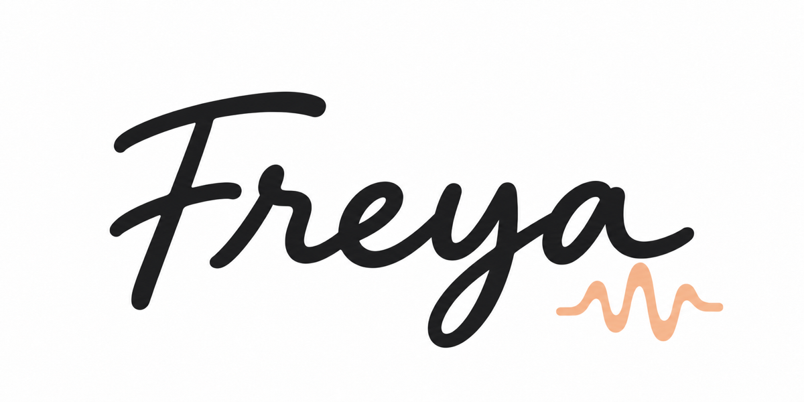

  

  

Freya is a music player for your own music collection, on macOS, Windows and Linux. Your library lives on one computer and plays on every computer in your home, for everyone you invite. The interface is drawn at your screen's full resolution, so it stays sharp at any size, and it is light on the computer while it plays.

Status: early, but in use.

## Download

[Download the latest release](https://github.com/alexvikman/freya/releases/latest). It comes in two parts:

- **Freya Server** keeps your music library. Install it on the computer your music is on, or that reaches it on a network drive. It runs in the background, with or without a screen.
- **Freya** plays the music. Install it on that computer and on any other computer in your home.

macOS takes the `.dmg`, Windows the `.msi`, Linux the `.AppImage` or `.deb`. Both apps check for updates and install them when you say so.

## Getting started

1. Install and start **Freya Server** on the computer with your music. In Freya's settings you can have it start at login.
2. Open **Freya**. It finds the server on this computer or on your network; you can also type its address. The first time, you choose a name and password for the server.
3. On another computer, Freya asks for the **connection code** of the server: Freya Server shows it in its menu (Show Connection Code), and Freya on the server's computer under Settings › Server › Add a device. This proves you reached your own server, and nobody else's.
4. Go to Settings › Library › **Manage Folders…** and choose your music folders. They are browsed from the server's side, so network drives the server reaches show up too. Freya reads them, finds the covers, and lists your music by artist and album.

To give someone else in your home their own account, an admin invites them under Settings › Account › Users: they type the invitation code on their computer and choose a password.

## What it does

**Library.** Browse by artist, album, genre or playlist, or search as you type: every word you type matches the start of a word in the artist, album, title or genre, and accents don't matter. Click an artist or album to open it, double-click a track to play it, or use **+** to add it to Up Next. Artists get a picture, a biography and their most played tracks. Freya keeps the library in step with your folders: it notices new and changed files, and you can set how often it reads them all again.

**Up Next.** What plays next. Drop files, folders or playlist files (M3U, M3U8, PLS) on the window to add what of them is in your library. Click, Shift-click and Ctrl/Cmd-click to select, drag to reorder, Delete to remove. Keep Up Next as a playlist from the File menu.

**Recents.** The clock in the toolbar shows what you played and added lately, by day, and what you play most.

**Radio.** Browse almost a hundred picked stations, lossless and hi-res among them, and tens of thousands more from Radio Browser, by genre, country, language, decade and quality. An admin saves stations for everyone on the server; any stream address plays with File › Play Stream URL…. The song title follows the station as it plays.

**Equalizer and visualizer.** Ten bands from 60 Hz to 16 kHz and a preamp: drag across several bands in one sweep, double-click one to reset it, pick a preset or load Winamp `.eqf` preset files. The visualizer shows a spectrum, an oscilloscope or a hologram; press `F` to fill the screen with it, for a TV, with what plays in large letters below.

**Artist information.** Freya can fetch biographies from Wikipedia and Last.fm and pictures from Deezer and fanart.tv, for the artists that lack them. Each source is a switch in Settings › Library, and each says what it is told.

**Last.fm.** Scrobble what you play to your Last.fm profile (Settings › Account).

**Media keys.** Freya shows what plays in the system's media controls (Now Playing on macOS, the media overlay on Windows, MPRIS on Linux), with cover art, and the keyboard's media keys control it.

**Backups.** The server's owner backs up everything the server keeps (Settings › Server): the library, pictures, playlists, stations and users, in one file, with a password if you want one. Restore it on the same computer or a new one. You can also export what the users made (playlists, plays, favourites, stations and changes, without passwords) and import it into another Freya Server, which finds the same tracks in its own folders.

**Skins.** Press `F2` to change how Freya looks, or install a `.freyaskin` file someone shared. Want to make one? See the [skin guide](docs/skins.md).

**In the terminal.** `freya play ~/Music/some-album` plays music or a radio stream without a window (on Windows, `freya-cli play …`).

## Keyboard shortcuts

| Key | Does |
|---|---|
| `Space` | Play or pause |
| `←` / `→` | Seek 5 seconds |
| `↑` / `↓` | Volume |
| `M` | Mute |
| `N` / `P` | Next / previous track |
| `S` | Stop |
| `O` | Open files |
| `F` | Full-screen visualizer (`Esc` leaves it) |
| `Ctrl/Cmd+F` | Search the library |
| `Ctrl/Cmd+,` | Settings |
| `Alt+←` / `Alt+→` (`Cmd+[` / `Cmd+]` on macOS) | Back and forward |
| `F1` | About Freya |
| `F2` | Skins |

In lists: the arrow keys, Page Up/Down, Home/End, Enter to play or open, `Esc` to go back, `Ctrl/Cmd+A` to select all in Up Next.

## Supported formats

MP3, FLAC, Monkey's Audio (APE, from version 3.95), WAV, AIFF, Ogg Vorbis, Opus, AAC and ALAC (M4A/MP4), CAF and MKV/WebM audio. A disc ripped as one file with a CUE sheet beside it shows as an album of its tracks. Radio streams in MP3, AAC, FLAC, Ogg Vorbis and Opus over HTTP and HTTPS. Playback is gapless.

## For developers

Building from source, the checks, packaging and how the code is laid out: [docs/DEVELOPMENT.md](docs/DEVELOPMENT.md).

## License

MIT OR Apache-2.0. The interface uses [Slint](https://slint.dev) under its royalty-free license, which asks that Slint is credited in the app.
